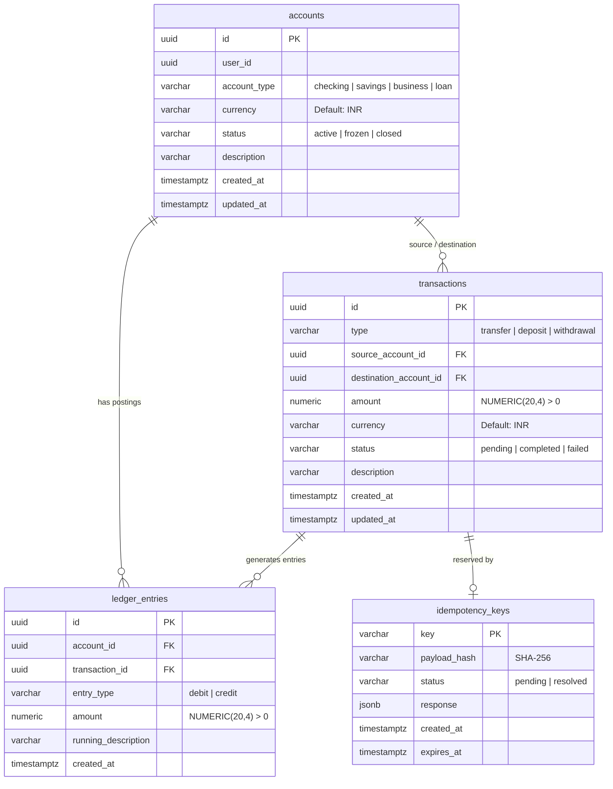

# LedgerGuard — Banking Transaction Integrity System

A high-integrity double-entry ledger and transaction engine built with **Node.js**, **Express**, and **PostgreSQL**. Engineered with strict ACID isolation (`REPEATABLE READ`), deterministic row locking to prevent deadlocks, database-enforced idempotency, continuous read-only reconciliation, and a self-contained local demonstration dashboard.

---

## ⚠️ Local Demonstration & Security Warning

> **IMPORTANT NOTICE:**
> LedgerGuard is designed and configured exclusively for **local demonstration and synthetic banking testing** on your local machine using PostgreSQL.
>
> **Do not deploy this application directly to a public or production network.**
> - It does not currently contain authentication layers (OAuth2, JWT, or sessions), multi-factor authentication (MFA/OTP), TLS termination, or role-based access control (RBAC).
> - Production deployment requires an enterprise secret manager (e.g., HashiCorp Vault / AWS Secrets Manager), perimeter rate limiting, API gateway firewalls, and audited vault clearing accounts.

---

## 1. Problem Statement & Motivation

Traditional CRUD banking systems that store a mutable `balance` column in an `accounts` table suffer from critical failure modes:
1. **Race Conditions & Double-Spending**: Concurrent transfer requests reading the same balance before writing can overdraw accounts or corrupt balance records.
2. **Deadlocks**: Bi-directional transfers between two accounts (A $\rightarrow$ B and B $\rightarrow$ A) running concurrently can lock records in reverse order, deadlocking database threads.
3. **Data Drift & Audit Inability**: In mutable balance tables, there is no verifiable mathematical proof that account balances accurately reflect historical transactions.
4. **Duplicate Transfers**: Network retries or browser double-clicks without database-enforced idempotency result in duplicate charges.
5. **Floating-Point Precision Errors**: Using JavaScript IEEE 754 floating-point numbers (`0.1 + 0.2 = 0.30000000000000004`) causes rounding errors in financial balances.

**LedgerGuard resolves these challenges** by implementing an append-only double-entry journal, database-level immutability rules, deterministic UUID lock ordering, atomic PostgreSQL-backed idempotency, exact database numeric arithmetic (`NUMERIC(20,4)`), and an automated ledger reconciliation engine.

---

## 2. System Architecture

```
LedgerGuard API Server (Express.js on Node.js)
├── EJS Demonstration UI (Local HTML/CSS/JS, zero external CDNs)
├── Middleware:
│   ├── validation.js          # Joi schema validation
│   ├── idempotency.js         # Idempotency-Key validation & extraction
│   └── errorHandler.js        # Sanitized error handler (no SQL/stack leaks)
├── Services:
│   ├── account.service.js     # Dynamic balance summation
│   ├── transaction.service.js # Deterministic locking + atomic double-entry
│   └── reconciliation.service.js # Read-only double-entry auditor
└── Persistence (PostgreSQL with pg connection pool):
    ├── accounts               # Account metadata and status
    ├── transactions           # High-level journal records
    ├── ledger_entries         # Append-only immutable credit/debit records
    └── idempotency_keys       # Unique-constrained request keys & responses
```

---

## 3. Database Schema & Entity-Relationship (ER) Diagram



### Database Immutability Enforcement
PostgreSQL rules block direct modification or deletion of ledger entries:
```sql
CREATE RULE no_update_ledger AS ON UPDATE TO ledger_entries DO INSTEAD NOTHING;
CREATE RULE no_delete_ledger AS ON DELETE TO ledger_entries DO INSTEAD NOTHING;
```

---

## 4. Double-Entry Invariants

For every transfer of amount $A$ from Account X to Account Y:
- **Debit Entry**: Account X is debited by amount $A$.
- **Credit Entry**: Account Y is credited by amount $A$.
- **Ledger-Derived Balance Formula**:
  $$\text{Balance} = \sum(\text{credits}) - \sum(\text{debits})$$
- Balances are computed in PostgreSQL via `COALESCE(SUM(CASE WHEN entry_type = 'credit' THEN amount ELSE -amount END), 0)::NUMERIC(20,4)`.

---

## 5. Environment Variables & Configuration

LedgerGuard reads its configuration exclusively from environment variables via `dotenv`. Create a `.env` file in the root directory (copied from `.env.example`):

| Variable | Description | Default / Example | Required |
| :--- | :--- | :--- | :--- |
| `PORT` | HTTP server port | `3000` | No |
| `DB_HOST` | PostgreSQL hostname | `localhost` | Yes |
| `DB_PORT` | PostgreSQL port | `5432` | Yes |
| `DB_NAME` | Local PostgreSQL database name | `ledgerguard_dev` | Yes |
| `DB_USER` | PostgreSQL user | `postgres` | Yes |
| `DB_PASSWORD` | PostgreSQL user password | *(Your local password)* | Yes |
| `NODE_ENV` | Application environment | `development` | No |

> 🔒 **Security Guarantee**: The `.env` file is strictly ignored by Git. No real passwords or secrets are ever tracked, logged, or printed.

---

## 6. Local Setup & Installation

### Prerequisites
- Node.js >= 18
- PostgreSQL >= 13 (with pgAdmin or psql)
- npm

### 1. Clone & Install Dependencies
```bash
git clone <repository-url>
cd LedgerGuard
npm install
```

### 2. Create the Local Database
Using `psql` or **pgAdmin**:
```sql
CREATE DATABASE ledgerguard_dev;
```

### 3. Configure `.env`
```bash
cp .env.example .env
```
Edit `.env` and set your local PostgreSQL credentials:
```env
PORT=3000
DB_HOST=localhost
DB_PORT=5432
DB_NAME=ledgerguard_dev
DB_USER=postgres
DB_PASSWORD=your_actual_local_password
NODE_ENV=development
```

### 4. Run Additive Migrations
Migrations are additive, idempotent, and safe to rerun against an existing database:
```bash
npm run db:migrate
```

### 5. (Optional) Seed Synthetic Demo Data
Seeds two demo accounts (Alice Checking & Bob Savings) with an initial 1000.0000 INR deposit. The seed script is idempotent and skips insertion if demo data already exists:
```bash
npm run db:seed
```

### 6. Start the Server
```bash
npm start          # Production mode
npm run dev        # Development mode with auto-reload
```
Server runs at: `http://localhost:3000`

---

## 7. Local Demonstration Dashboard

Open `http://localhost:3000/dashboard` (or `http://localhost:3000`) in your browser.

The dashboard includes:
- **System Metrics**: Total active accounts, total ledger liquidity, recorded transactions, and real-time reconciliation status.
- **Account Ledger & Balances**: Search and filter accounts, copy UUIDs with 1 click, and audit individual account ledger postings.
- **Recent Transaction Trail**: Real-time journal stream of completed and pending transactions.
- **Transfer Simulator**:
  - Live execution of `POST /transfers`.
  - Automatic `Idempotency-Key` generation and manual overrides.
  - **Test Replay Button**: Tests identical replay behavior returning HTTP 200 with `replayed: true`.
  - **Test Conflict Button**: Mutates payload with the same key to verify HTTP 409 Conflict.
- **Ledger Reconciliation Monitor**: On-demand "Re-Audit Ledger" button displaying double-entry balance status and discrepancy breakdowns.

---

## 8. API Reference & Examples

### Health Check
```http
GET /health
```
Response `200 OK`:
```json
{ "status": "ok", "timestamp": "2026-10-26T18:30:00.000Z" }
```

### Create Account
```http
POST /accounts
Content-Type: application/json

{
  "userId": "a8098c1a-f86e-11da-bd1a-00112444be1e",
  "accountType": "checking",
  "currency": "INR",
  "description": "Primary Checking"
}
```

### Retrieve Account with Ledger Balance
```http
GET /accounts/:accountId
```

### Retrieve Account Ledger Postings
```http
GET /accounts/:accountId/ledger
```

### Execute Atomic Transfer (Double-Entry & Idempotent)
```http
POST /transfers
Content-Type: application/json
Idempotency-Key: transfer-payroll-oct-2026-001

{
  "sourceAccountId": "7b049d1e-e818-4a92-bce4-672ceef00384",
  "destinationAccountId": "a67b6cb7-9bca-4627-9e3b-76994b6c6623",
  "amount": 250.0000,
  "currency": "INR",
  "description": "Monthly savings allocation"
}
```

**Responses:**
- `201 Created`: Fresh transfer completed; returns transaction record and two balanced ledger entries.
- `200 OK` (`"replayed": true`): Identical retry with same key; returns original transaction without creating duplicate ledger entries.
- `409 Conflict`: Key was previously used with a different transfer payload.
- `422 Unprocessable Entity`: Business logic rejection (insufficient funds, frozen account, or currency mismatch).

### Run Ledger Reconciliation Audit (Read-Only)
```http
GET /reports/reconciliation
```
Optional query filters: `transactionId`, `status`, `limit`, `offset`.

---

## 9. Automated Testing

All tests run locally against the PostgreSQL database configured in your `.env`.

```bash
npm test
```

### Test Suite Verification:
- **Test Suites**: 2 passed (`tests/api.test.js`, `tests/dashboard.test.js`)
- **Total Tests**: 61 passed, 0 failed
- **Coverage Areas**:
  - Account lifecycle, validation, and ledger balance aggregation
  - Deposits, withdrawals, and balance-floor constraints (no negative balances)
  - Atomic transfer execution with deterministic row lock sorting
  - Inactive and frozen account transaction blocking
  - Ledger immutability (route absence and DB-level rules)
  - Complete Idempotency protocol (validation, replays, 409 conflicts, rollback on failure, concurrent races)
  - Ledger Reconciliation Engine (pattern checks, missing/extra entries, direction errors, amount mismatches, currency inconsistencies)
  - EJS Dashboard HTML rendering, static assets serving, and read-only sub-endpoints

---

## 10. Architectural Limitations

1. **Single-Entry Deposits & Withdrawals**: Deposits currently credit a user account without an offsetting debit to a central bank clearing vault; withdrawals debit a user account without an offsetting credit to a cash clearing liability account.
2. **Single-Node Database**: Uses single-instance PostgreSQL concurrency controls (`FOR UPDATE` row locks). High-throughput global clustering would require distributed locking or partition sharding.
3. **Idempotency Polling Concurrency**: Simultaneous concurrent requests for an in-flight key poll using exponential backoff until the winning transaction commits or rolls back.

---

## 11. Attribution & Original Work Statement

The initial skeleton of this application was based on an open-source educational mock banking API starter repository providing basic Express routes and PostgreSQL queries.

**Original Engineering Additions & System Enhancements:**
- Engineered deterministic lexicographical account row locking (`[srcId, dstId].sort()`) in `TransactionService` to prevent bi-directional transfer deadlocks.
- Implemented PostgreSQL-enforced atomic idempotency architecture (`idempotency_keys` table with unique constraint and SHA-256 payload hashing) for `POST /transfers`.
- Built the automated, read-only Ledger Reconciliation Engine (`src/services/reconciliation.service.js`) with exact numeric validation across 8 distinct discrepancy types.
- Engineered the self-contained demonstration EJS dashboard, custom CSS design system, and client-side simulator with idempotency testing controls.
- Re-architected schema migrations into additive, idempotent, and non-destructive scripts.
- Expanded the automated test suite from initial starter tests to 61 comprehensive integration tests with zero failures.
